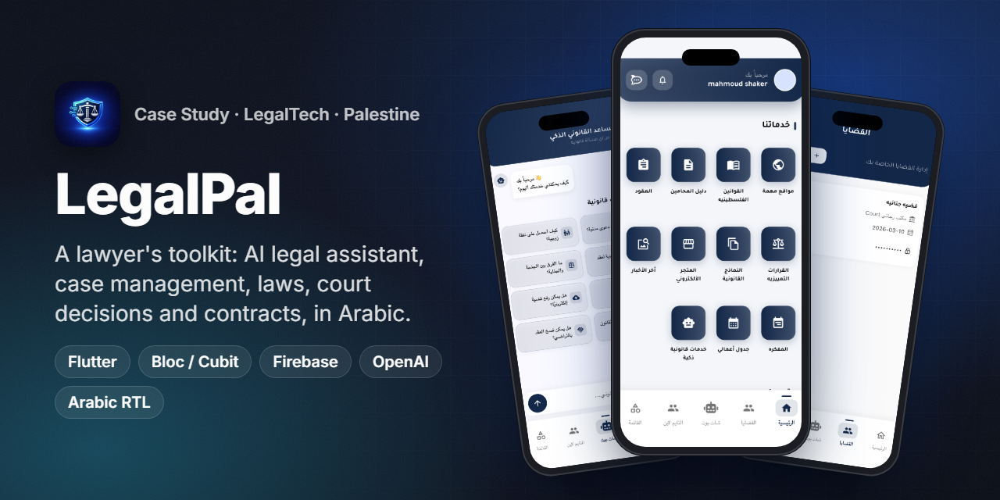
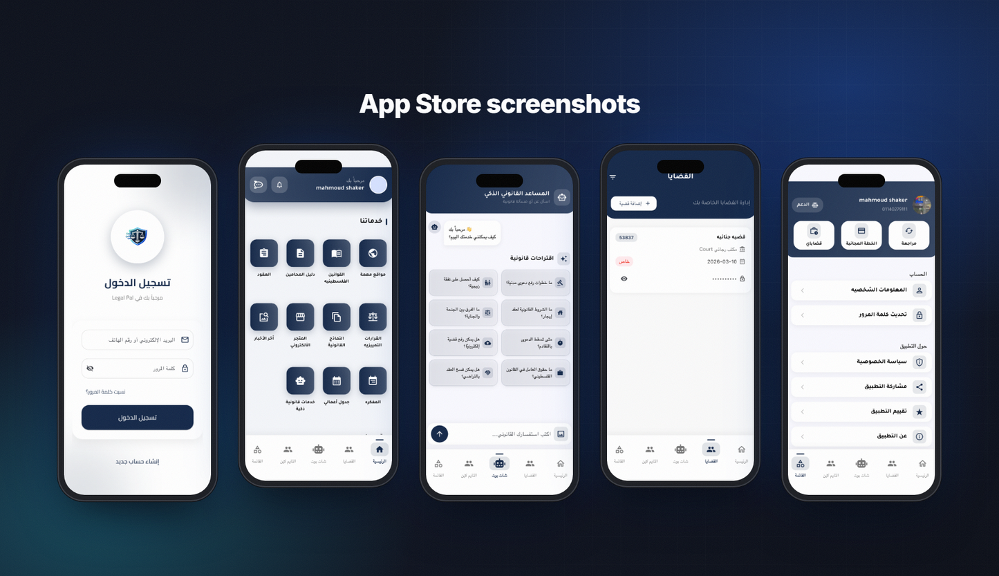
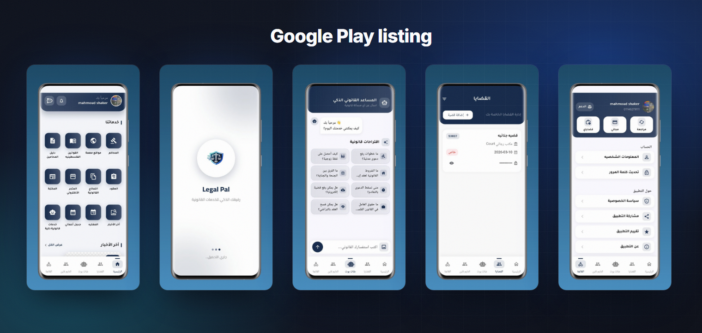
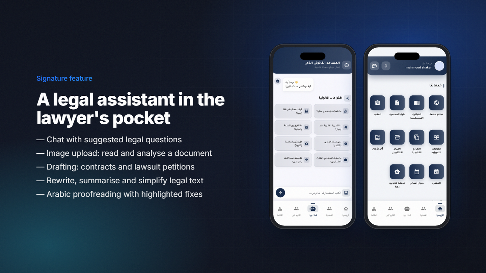
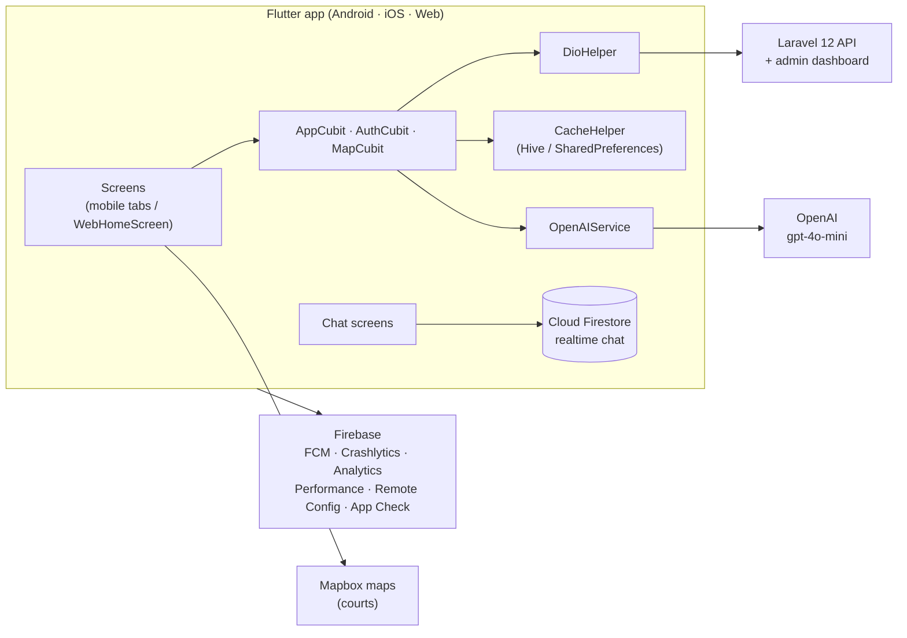

<h1 align="center">LegalPal</h1>

<b>A smart legal platform for lawyers in Palestine: AI assistant, case management, laws, court decisions and contracts in one Arabic app.</b>

  
  
  
  
  
  
  
  
  

> ℹ️ This is a case study. The source code belongs to the client and is not included.

## Overview

**LegalPal** is a legal platform built for lawyers in Palestine. A lawyer opens one app to:

- ask an AI legal assistant
- manage cases and the daily agenda
- look up Palestinian laws and court decisions
- generate contracts and legal forms
- read legal news
- talk to colleagues and support

It ships on Android, iOS and the web from one Flutter codebase.

I was the **Flutter developer** for the mobile apps and the web platform. That covered the app architecture, all screens, the AI features, realtime chat, store releases, and a dedicated desktop web layout (see the [web case study](https://github.com/ANaSHaker/legalpal-web-case-study)). The backend is a Laravel 12 API with an admin dashboard.

LegalPal shares its engine with [Mohami Plus](https://github.com/ANaSHaker/mohami-plus-app-case-study), the Iraqi sister product. The two apps have different brands, legal content and feature sets. LegalPal focuses on the **working lawyer**: case files, an agenda, a professional timeline and an e-store. Mohami Plus focuses on citizens and AI document drafting.

Version 1.0 reached the App Store in May 2026.

## The challenge

- **Lawyers juggle five tools.** They use a PDF of the law, a WhatsApp group, a paper agenda, Word templates and a search engine. LegalPal had to replace them with one fast Arabic app.
- **Legal content is long and structured.** Laws, court decisions and procedures need search, categories and readable detail pages on small screens.
- **AI that helps with the actual job.** Lawyers need drafting, summarising, rewriting and proofreading in formal Arabic, not a generic chatbot.
- **One codebase for phone, tablet and desktop**, while keeping native features such as maps, push notifications and image upload on mobile.

## Highlights

**🤖 AI legal assistant (OpenAI)**
- A chat assistant with conversation history and suggested questions about Palestinian law.
- Smart legal services:
  - legal consultation
  - contract and lawsuit-petition drafting
  - legal rewriting
  - summarising
  - term explanations
  - simplifying legal text
  - advanced legal analysis
- **Image analysis:** photograph a document to have it read and analysed.
- **Arabic proofreading** with highlighted corrections.

**📚 Legal knowledge base**
- Palestinian laws, court decisions (القرارات التمييزية), legal clauses, procedure steps, books and useful external sites.
- Legal news with detail pages, plus general legal information.

**🗂️ Lawyer workspace**
- Case management: add cases, follow sessions and updates, search cases, and protect sensitive files with a password.
- My agenda (جدول أعمالي) for appointments and a notebook (المفكرة) for notes.
- Contracts with fillable fields and PDF output, plus a library of legal forms.

**👥 Community and services**
- A lawyer directory with profiles, and a court directory with **Mapbox** maps.
- A timeline of lawyers' posts, realtime chat with support (**Cloud Firestore**), and requests for legal services.
- An e-store, subscriptions and push notifications (FCM).

## Screens

Sign-in, home services, AI assistant, cases and account (App Store screenshots).

Google Play listing: home, splash, AI assistant, cases and account.

> The screenshots come from the public store listings. The account shown is the developer's own test account.

## Signature feature: a legal assistant in the lawyer's pocket

- **Chat first.** The assistant opens with suggested questions, such as how to file a civil lawsuit, the difference between a misdemeanor and a felony, or labour rights under Palestinian law. The lawyer starts with one tap.
- **Context.** The conversation history goes back with every message, so follow-up questions work naturally.
- **Specialised modes.** Drafting, rewriting, summarising, simplifying and analysis use dedicated system prompts. Each returns formal, structured Arabic.
- **Vision.** The lawyer attaches a photo of a contract or a ruling. The assistant extracts the text and analyses it.
- **Proofreading.** The assistant returns the corrected text with each fix highlighted, so the lawyer can review the changes instead of re-reading everything.

## Architecture & stack

| Layer | Technology |
|---|---|
| App | Flutter / Dart, Material, Arabic RTL, `flutter_screenutil` + `sizer` for responsive sizing |
| State | `flutter_bloc` (AppCubit, AuthCubit, MapCubit) |
| Networking | Dio wrapper (`DioHelper`), `http` |
| Storage | Hive, SharedPreferences (`CacheHelper`) |
| Realtime | Cloud Firestore (support chat), `socket_io_client` |
| AI | OpenAI (`gpt-4o-mini`) via `dart_openai` and REST, with vision input |
| Maps and location | `mapbox_maps_flutter`, `geolocator`, `location` |
| Firebase | Messaging, Crashlytics, Analytics, Performance, Remote Config, App Check |
| Documents | `pdf`, `open_filex`, `flutter_html`, `image_picker` |
| Backend | Laravel 12 REST API with a Blade admin dashboard |

## Engineering notes

- **One router, two experiences.** `AppRouter` serves the phone bottom-navigation layout on Android, iOS and iPad, and a separate `WebHomeScreen` for desktop browsers. On the web the app starts at an embedded landing page. On mobile it starts at onboarding or the splash screen. Business logic stays in the same cubits.
- **Realtime support without a socket server.** Support chat runs on Cloud Firestore streams, so messages arrive instantly without extra backend infrastructure. On the web, chats open as floating Messenger-style panels.
- **Crash and performance monitoring.** Crashlytics, Performance and Analytics are wired in at startup. `FirebaseMonitoringService` adds custom traces. On the web, mobile-only plugins are skipped behind `kIsWeb` guards.
- **Force update through Remote Config.** An update service compares the installed version with a Remote Config value and shows a blocking force-update screen when a critical fix ships.
- **Arabic-first UI.** All layouts are RTL by default, with Arabic fonts and Arabic-formatted dates. A guest mode lets people explore before registering.

## Results

- **Live on Google Play** ([com.legalapp.pal](https://play.google.com/store/apps/details?id=com.legalapp.pal)) with **100+ installs**.
- **Live on the App Store** ([LegalPal](https://apps.apple.com/sa/app/legalpal/id6761775155)) since May 2026, version 1.0, in the Business category.
- Also available as a web platform with a desktop layout ([web case study](https://github.com/ANaSHaker/legalpal-web-case-study)).

## بالعربي

**LegalPal** منصة قانونية ذكية للمحامين في فلسطين، تعمل على أندرويد وآيفون والويب من كود Flutter واحد.
تجمع مساعدًا قانونيًا بالذكاء الاصطناعي (محادثة، وصياغة عقود ولوائح، وتلخيص، وتدقيق لغوي، وتحليل صور المستندات)، وإدارة القضايا والجلسات، وجدول الأعمال، والمفكرة.
وتضم أيضًا القوانين الفلسطينية، والقرارات التمييزية، والنماذج والعقود بصيغة PDF، ودليل المحامين والمحاكم على الخريطة، ومحادثة دعم فورية.
قمت بتطوير التطبيق بالكامل (موبايل وويب) ونشره على Google Play وApp Store.

## Links

- ▶️ [Google Play](https://play.google.com/store/apps/details?id=com.legalapp.pal)
- 🍎 [App Store](https://apps.apple.com/sa/app/legalpal/id6761775155)
- 🧩 Related: [LegalPal web](https://github.com/ANaSHaker/legalpal-web-case-study) · [Mohami Plus (sister product)](https://github.com/ANaSHaker/mohami-plus-app-case-study)

---
<h3 align="center">Built by Mahmoud Shaker — Senior Flutter Engineer</h3>

  
  
  
  
  
  
  

